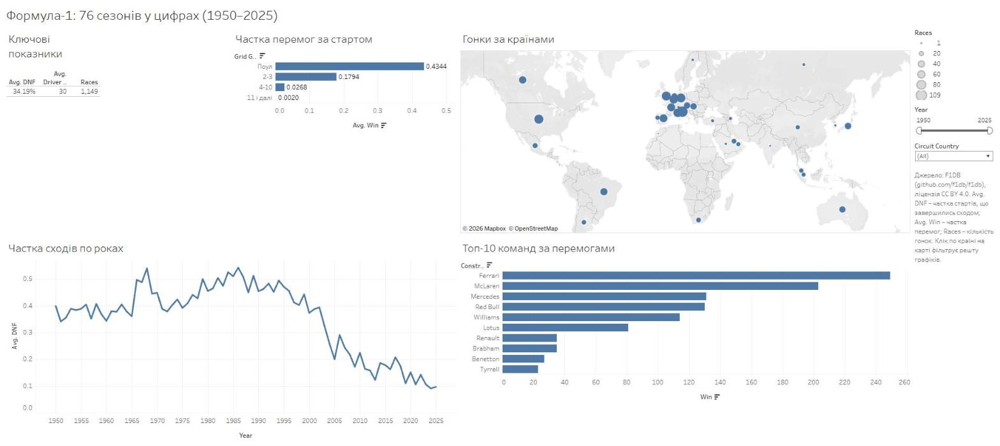

# Статистичний аналіз результатів чемпіонату світу Формули-1 (1950–2025)

Курсова робота з дисципліни «Мови програмування для аналізу даних».
Виконав(ла): Юхно О. В., група 401-ТН, НУ «Полтавська політехніка імені Юрія Кондратюка».

[](https://colab.research.google.com/github/CYBEROUT-me/f1-data-analysis/blob/main/notebooks/analysis.ipynb)

## Мета

Дослідити, як за 76 сезонів змінювались конкурентність, надійність машин і результати гонок
Формули-1 та від чого залежить результат пілота в гонці.

Дослідницькі питання:

1. Як змінювалась конкурентність чемпіонату (кількість різних переможців, домінування найсильнішої команди)?
2. Наскільки стартова позиція визначає результат і чи відрізняються в цьому вуличні траси?
3. Як змінились надійність машин і причини сходів з дистанції?
4. Хто з пілотів і команд найефективніший і як змінювались лідери по десятиліттях?
5. Чи змінився вік пілотів і чи є перевага домашньої гонки?
6. Як змінився час піт-стопів?

## Дані

**Джерело:** [F1DB – Open Source Formula 1 Database](https://github.com/f1db/f1db),
реліз [`v2026.20.0`](https://github.com/f1db/f1db/releases/tag/v2026.20.0) від 9 листопада 2026 року.
Ліцензія – [CC BY 4.0](https://creativecommons.org/licenses/by/4.0/), тому таблиці можна зберігати в репозиторії
із зазначенням джерела.

Використано 8 таблиць (`data/raw`):

| Файл | Зміст | Рядків |
|---|---|---|
| `f1db-races-race-results.csv` | результати кожного пілота в кожній гонці | 27 731 |
| `f1db-races.csv` | гонки: дата, траса, Гран-прі | 1 172 |
| `f1db-drivers.csv` | пілоти: дата народження, громадянство | 921 |
| `f1db-constructors.csv` | команди | 187 |
| `f1db-circuits.csv` | траси: тип, країна, координати | 78 |
| `f1db-countries.csv` | довідник країн | 249 |
| `f1db-grands-prix.csv` | назви Гран-прі | 54 |
| `f1db-races-pit-stops.csv` | піт-стопи з 1994 року | 22 755 |

Сезон 2026 на момент релізу не завершений (20 з 23 гонок), тому аналіз охоплює 1950–2025 роки.
Якщо папки `data/raw` немає, ноутбук сам завантажує архів `f1db-csv.zip` з релізу F1DB.

## Структура проєкту

```
f1-data-analysis/
├── data/
│   ├── raw/                  # вихідні таблиці F1DB
│   └── processed/            # очищені дані (f1_starts_clean.csv)
├── notebooks/
│   └── analysis.ipynb        # основний ноутбук аналізу
├── results/
│   ├── figures/              # 8 графіків (PNG, 200 dpi)
│   └── exports/              # рейтинги та зведені таблиці
├── tableau/                  # дані та інструкція для дашборда
├── requirements.txt
└── README.md
```

## Технології

Python 3.11, Pandas, NumPy, Matplotlib, Seaborn, Jupyter / Google Colab, Tableau Public.

## Запуск

Локально:

```bash
git clone https://github.com/CYBEROUT-me/f1-data-analysis.git
cd f1-data-analysis
pip install -r requirements.txt
jupyter notebook notebooks/analysis.ipynb
```

У Google Colab – кнопка «Open in Colab» вгорі. Дані завантажуються автоматично в першій частині ноутбука.
Ноутбук виконується послідовно від початку до кінця (Run all).

## Основні результати

- З поулу виграно 43 % усіх гонок, у 2010–2025 роках – 52 %; з 10-го місця і далі – лише 3.5 % перемог.
- Частка сходів з дистанції впала з 49 % стартів у 1980-х до 11 % у 2020-х.
- У 2010-х і 2020-х найсильніша команда сезону в середньому вигравала 66 % гонок; рекорд – Red Bull, 2023 (95.5 %).
- Середній вік пілотів зменшився з 35 до 28 років; переваги домашньої гонки не виявлено.
- Медіанний час проїзду піт-лейну скоротився з 30.6 с (1994) до 23.3 с (2025).

## Дашборд Tableau Public

**[Формула-1: 76 сезонів у цифрах (1950–2025)](https://public.tableau.com/app/profile/oleksander.yukhno/viz/F11950-2025-1/-17619502025)** – 5 аркушів
(ключові показники, карта гонок за країнами, частка сходів по роках, топ-10 команд, частка перемог за стартом),
фільтри за роками й країною, клік по карті фільтрує решту графіків. Опис – у [`tableau/README.md`](tableau/README.md).


