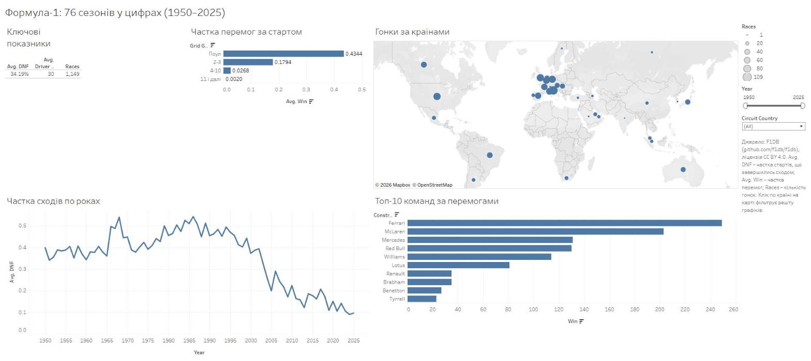

# Дашборд у Tableau Public

**Опублікований дашборд:** https://public.tableau.com/app/profile/oleksander.yukhno/viz/F11950-2025-1/-17619502025

## Дані

Файли в цій папці створює ноутбук `notebooks/analysis.ipynb` (розділ 7):

| Файл | Що містить |
|---|---|
| `f1_starts.csv` | один рядок = один старт пілота (25 518 рядків, 1950–2025) – джерело даних дашборда |
| `f1_seasons.csv` | підсумки сезонів: гонки, пілоти, частка сходів, різні переможці, частка перемог найсильнішої команди |
| `f1_pit_stops.csv` | піт-стопи 1994–2025 (без зупинок понад 120 с) |

Поля `Win`, `Podium`, `DNF`, `Home Race` у `f1_starts.csv` – прапорці 0/1, тому їх середнє одразу дає частку
(`AVG(DNF)` – частка сходів, `AVG(Win)` – частка перемог).

## Структура дашборда «Формула-1: 76 сезонів у цифрах (1950–2025)»

Обчислюване поле: `Races` = `COUNTD([Race Id])` – кількість гонок.

| Аркуш | Що показує | Як побудовано |
|---|---|---|
| Ключові показники | частка сходів, середній вік пілота, кількість гонок | текстова таблиця: `AVG(DNF)` (у відсотках), `AVG(Driver Age)`, `Races` |
| Гонки за країнами | у яких країнах і скільки гонок проведено | карта: `Circuit Country` (географічна роль), розмір – `Races` |
| Частка сходів по роках | динаміка надійності | лінія: `Year` × `AVG(DNF)` |
| Топ-10 команд за перемогами | найуспішніші команди | стовпчики: `Constructor` × `SUM(Win)`, фільтр Top 10 |
| Частка перемог за стартом | вплив стартової позиції | стовпчики: `Grid Group` × `AVG(Win)`, без невідомих позицій |

## Інтерактивність

- слайдер **Year** – діапазон сезонів, застосовано до всіх аркушів джерела даних;
- випадний список **Circuit Country** – вибір країн траси, застосовано до всіх аркушів;
- **дія-фільтр**: клік по країні на карті фільтрує решту графіків.

## Як оновити

Після повторного запуску ноутбука: Tableau Public → відкрити робочу книгу → Data → замінити джерело на новий
`f1_starts.csv` → Publish.
